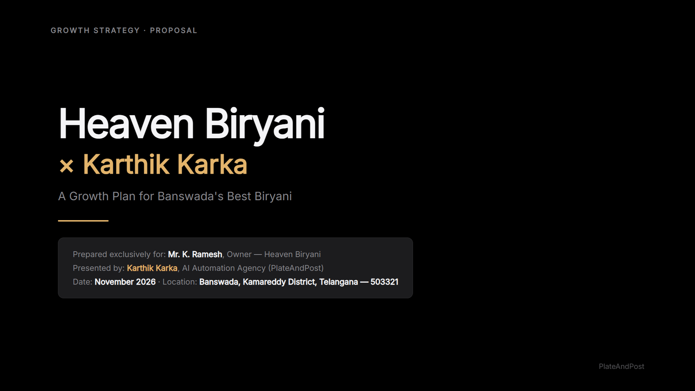
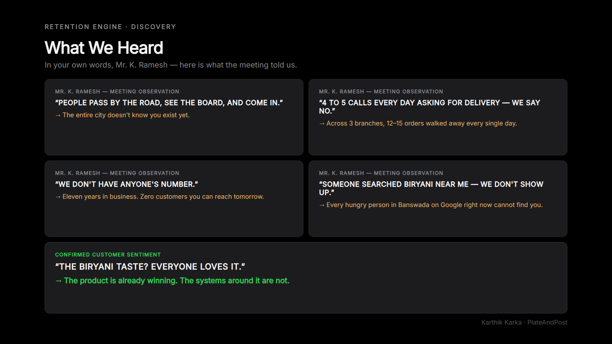
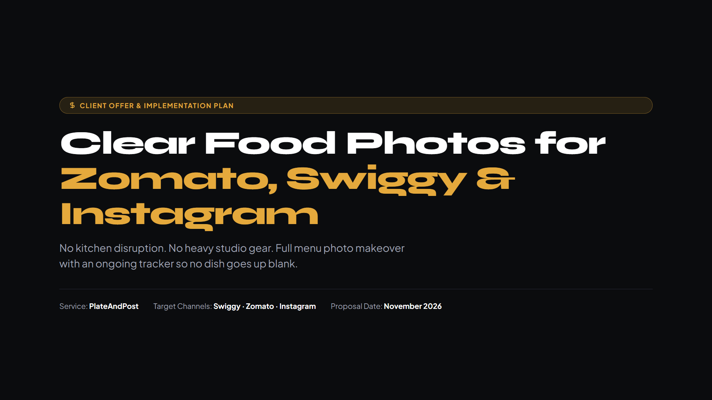
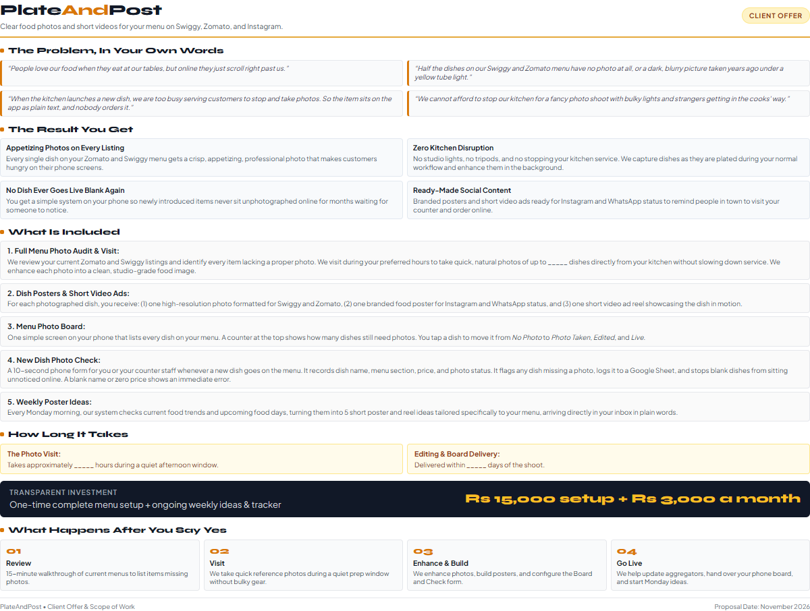

# PlateAndPost — Automated Client Solution Proposal & Offer Engine

[](https://pptr.dev/)
[-E3B46B?style=flat)](https://pdf-lib.js.org/)
[](./LICENSE)

**Automated Client Solutions & Proposal Engineering** — A programmatic HTML/CSS-to-PDF rendering pipeline built with **Puppeteer** and **`pdf-lib`** that generates executive-grade `1920×1080` widescreen strategy decks and `A4` one-page client offers, complete with automated per-slide screenshot verification.

> **Sample Case Study Notice:** All client names (*Heaven Biryani*, *Mr. K. Ramesh*), discovery quotes, revenue estimates, and pricing (`Rs 15,000 setup + Rs 3,000/month`) inside these templates are **sample demonstration case studies** created to showcase solution engineering and agency proposal automation.

---

## Why We Are Proposing, What We Are Offering & Why We Built This

### 1. Why We Are Proposing This Solution
During discovery with small restaurants and cafes, a recurring operational pattern appears:
* **Strong Product, Weak Digital Presence:** Customers love the food in person, yet online listings on **Zomato and Swiggy** have missing or low-light photos—causing hungry users to scroll past.
* **Lost Off-Platform Demand:** Walk-in/call inquiries for delivery or local *"near me"* searches go uncaptured when there is no customer phone directory or automated follow-up system.
* **Kitchen Bottlenecks:** Kitchen staff cannot pause service for bulky studio shoots when launching new dishes, leaving new items as blank text on delivery apps for months.

### 2. What We Are Offering (End-to-End Solution Package)
The generated proposals translate those business bottlenecks into a concrete 4-part deliverable:
1. **Menu Photo Audit & Zero-Disruption Capture:** Audit Swiggy/Zomato gaps and capture dishes during normal plating hours.
2. **Delivery Visuals, Posters & Reels:** High-resolution aggregator photos, branded Instagram/WhatsApp posters, and short video ads.
3. **Menu Photo Board & New Dish Check:** A mobile tracker app ([menu-photo-board](https://github.com/karthikkarka/menu-photo-board)) + 10-second n8n intake form ([n8n-cafe-automations](https://github.com/karthikkarka/n8n-cafe-automations)) so no new dish ever launches without a photo.
4. **Automated Weekly Marketing Ideas:** Scheduled AI trend digest ([cafe-news-digest-agent](https://github.com/karthikkarka/cafe-news-digest-agent)) delivering weekly poster & reel concepts.

### 3. Why We Built This Automation Pipeline
Hand-editing presentation slides for every prospective restaurant slows down outreach and creates layout inconsistencies. Building proposals as **structured HTML/CSS templates rendered through Puppeteer + `pdf-lib`** ensures:
* **Exact `1920×1080` Widescreen Fidelity:** Scales Chrome's 72 DPI PDF output (`1440pt`) by `4/3` via `pdf-lib` so every slide is mathematically verified at `1920×1080`.
* **Zero Overlap & Accessibility Checks:** Renders PNG screenshots of every single slide (`checks/`) and enforces WCAG AA contrast ratios before delivery.
* **Offline Typography:** Bundles `@fontsource/inter` locally for deterministic rendering.

---

## Included Suites

### 1. Strategy Pitch Deck (`strategy-deck/`)
* **16-Slide Apple Keynote Dark Bento Grid Deck** (`#000000` canvas, `#1C1C1E` bento cards, `#E3B46B` gold, `#30D158` green) — Sample Case Study: *Heaven Biryani × PlateAndPost*.
* **Output:** [`strategy-deck/output/proposal.pdf`](./strategy-deck/output/proposal.pdf) (16 pages, verified `1920×1080`).

### 2. Client Offer Deck & One-Pager (`client-offer/`)
* **8-Slide Offer Deck** (`PlateAndPost-Proposal-Deck.pdf`, `1920×1080`) + **1-Page A4 Commercial Offer** (`PlateAndPost-One-Page-Offer.pdf`).
* **Outputs:** [`client-offer/output/`](./client-offer/output/).

---

## Visual Previews (Sample Case Study)

| Strategy Cover (Slide 1) | Discovery Insights (Slide 2) | Client Offer Deck (Slide 1) | 1-Page A4 Offer |
| :---: | :---: | :---: | :---: |
|  |  |  |  |

---

## Run Locally

```bash
cd strategy-deck
npm install
node make-pdf.mjs
node verify-pdf.mjs
```

---

## License

MIT License — Copyright (c) 2026 Karthik Karka. See [LICENSE](./LICENSE).
